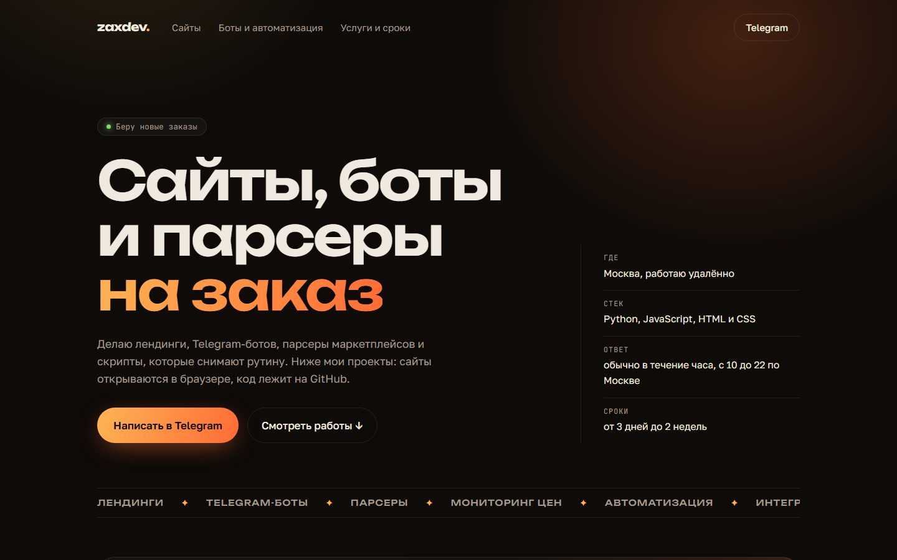
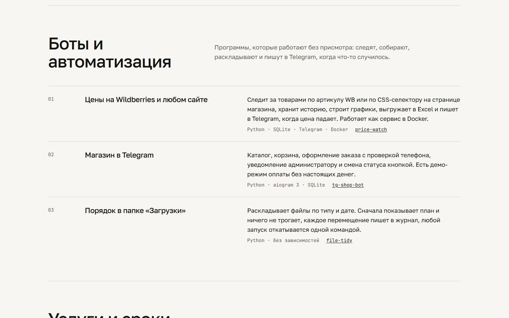
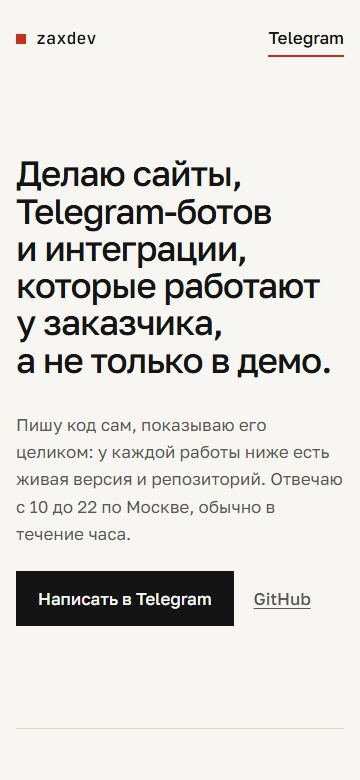

# zaxdev

Personal portfolio: websites, Telegram bots, scrapers and automation.

Сайт-витрина: кто я, что делаю и как со мной связаться. На первом экране одна фраза и кнопка в Telegram, ниже работы с живыми превью, отдельный раздел про ботов и автоматизацию, описанных через задачу, услуги со сроками.

Сайт: https://zaxdevv.github.io/zaxdev-portfolio/







## Что на странице

- Первый экран на тёмном фоне с оранжевым свечением: чем занимаюсь, кнопка «Написать в Telegram», короткая справка о стеке и сроках. Под ним бегущая строка с видами работ.
- «Сейчас»: pulsewatch, мониторинг сайтов, со скриншотом интерфейса.
- Пять сайтов: крупное превью в рамке браузера, одна строка о том, чем сайт интересен, ссылки на живую версию и на код.
- «Боты и автоматизация»: [LeadMind CRM](https://zaxdevv.github.io/zaxdev-portfolio/#leadmind) с настоящим скриншотом, бизнес-сценарием, возможностями, стеком и ссылкой на запуск; ниже трекер цен, магазин в Telegram и сортировщик файлов.
- Услуги и сроки без цен, порядок работы, контакт.

## Как запустить

```sh
git clone https://github.com/zaxdevv/zaxdev-portfolio
cd zaxdev-portfolio
python -m http.server 8000
```

## Как устроено

Один `index.html` и `css/style.css`, JavaScript нет. Шрифты Unbounded (заголовки), Golos Text и JetBrains Mono лежат локально в `fonts/`, все под SIL Open Font License. Бегущая строка останавливается, если в системе включено уменьшение движения. Превью работ в `img/` сняты с первых экранов в AVIF и WebP, около 50 КБ каждое.

Для версии до добавления LeadMind: Lighthouse (мобильный профиль) — 100 по четырём пунктам, axe и html-validate без ошибок. Актуальные проверки кейса описаны в [docs/verification.md](docs/verification.md).

## Лицензия

Код распространяется по MIT, см. [LICENSE](LICENSE).
